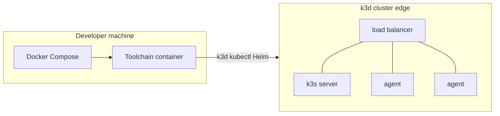
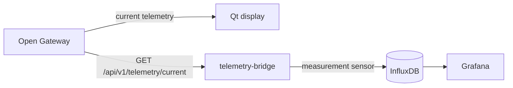
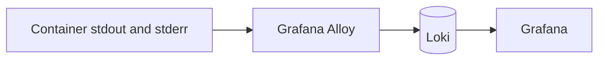

# Architecture

This repository is the Kubernetes cluster. It provisions a multi-node k3s cluster, runs an edge workload in it, and keeps that workload recoverable, scalable, and observable.

The C++ Open Gateway is that workload. Its source code is the submodule `external/open-gateway`, not part of this repository. This repository builds the image, imports it, and runs it. The gateway supplies simulated sensors and one target sensor, motor control. InfluxDB stores the readings. Grafana displays them.

## Cluster

Docker is the only host dependency. A toolchain container runs `k3d`, `kubectl`, and Helm against the host Docker socket. `k3d` reads `infra/cluster/k3d.yaml` and creates the cluster `edge`: one k3s server and two agents (`rancher/k3s:v1.32.2-k3s1`). Traefik is disabled. Host access is a set of ports on the k3d load balancer.

Everything this platform installs lives in the namespace `edge`.

## Workloads

| Workload | Runs as | Installed by |
| --- | --- | --- |
| `open-gateway` | Deployment, 1 replica, rolling update `maxUnavailable: 0`, `maxSurge: 1` | Kubernetes manifest |
| `open-gateway-display` | Deployment, 1 replica, Qt window through noVNC | Kubernetes manifest |
| `telemetry-bridge` | Deployment, 1 replica | Helm chart in this repository |
| `influxdb` | Stateful workload and a 1Gi PersistentVolumeClaim on `local-path` | Upstream Helm chart |
| `loki` | Single binary and a PersistentVolumeClaim on `local-path` | Upstream Helm chart |
| `alloy` | DaemonSet, one Pod per node | Upstream Helm chart |
| `grafana` | Deployment and a NodePort Service | Upstream Helm chart |

Gateway and display images are built in the toolchain and imported with `k3d image import`. Their Pods use `imagePullPolicy: Never`. The bridge image is imported the same way.

The gateway Service `open-gateway` is ClusterIP. The display and the bridge call it at `http://open-gateway.edge.svc.cluster.local:8080`. A second Service, `open-gateway-host`, is a NodePort so the same API is reachable from the host. InfluxDB stays ClusterIP. Only the bridge and Grafana use it.

## Readings

On each start, including after a restart, a scale-up, or a rolling update, the gateway Pod turns the temperature simulator on. The bridge polls the gateway every 5 seconds and writes numeric readings to the `sensors` bucket. Each point is the measurement `sensor`, tagged with device id and capability id. Grafana provisions that datasource and the **Edge sensors** dashboard from the chart.

Steady state is one gateway Pod and one bridge Pod. A scale-up shows two Ready gateway Pods and two Service endpoints, then the Deployment returns to one replica so the bridge does not write the same reading twice.

## Logs

Alloy runs on every node and ships stdout and stderr from every container. Each stream is labeled with namespace, Pod, and container. Loki keeps those lines on its own volume. The **Edge logs** dashboard reads them after the Pod that wrote them has been replaced.

## Host ports

`infra/cluster/k3d.yaml` publishes three ports on `127.0.0.1`. The NodePorts are set by the Service manifests and the Grafana chart.

| On the host | In the cluster | Workload |
| --- | --- | --- |
| `127.0.0.1:30080` | NodePort `30080` | Grafana |
| `127.0.0.1:8080` | NodePort `30081` | Gateway API |
| `127.0.0.1:6080` | NodePort `30082` | Qt display |

Logins and the InfluxDB organization, bucket, and token are in [Demo credentials](DEMO_CREDENTIALS.md).

## What the cluster is built to show

- **Create and delete** follow `infra/cluster/k3d.yaml`. `k3d cluster create --config` and `k3d cluster delete` are the provision and destroy path.
- **A deleted InfluxDB Pod** comes back on the same PersistentVolumeClaim, and earlier `sensor` points are still queryable.
- **A deleted gateway Pod** is replaced by the Deployment. Probes use `GET /api/v1/health`.
- **Scale** moves the gateway from 1 replica to 2 and back to 1. The bridge stays at 1 replica.
- **A rolling update** changes a Pod-template label and rolls with `maxUnavailable: 0`.
- **Logs** of a replaced Pod remain on the Loki volume and on the Edge logs dashboard.
