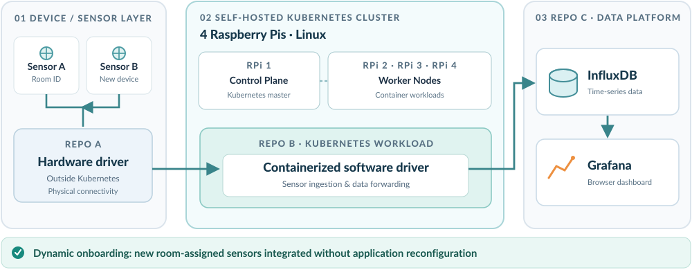

= Kubernetes-Based Platform for Dynamic Sensor Integration
Frank Brase
:author: Frank Brase
:doctype: article
:lang: en
:notitle:
:toc!:
:sectnums!:
:imagesdir: .
:pdf-theme: edge-reference-v2
:pdf-themesdir: {docdir}

// Project reference, deliberately limited to work performed in the ITK
// demonstrator. No confidential source code or project artifacts are included.
// For the same appearance, keep this source, the SVGs and YAML theme together.

[.kicker]
FRANK BRASE  /  KUBERNETES PROJECT REFERENCE

[discrete]
== Kubernetes-Based Platform for Dynamic Sensor Integration

[.subline]
Internal technology demonstrator  |  Self-hosted Kubernetes  |  Edge / IoT architecture

[discrete]
=== PROJECT OBJECTIVE

Build and validate a self-hosted Kubernetes-based platform that integrates new room-assigned sensors *without changing the existing application configuration*. The design was also considered for automotive sensor visualization.

[discrete]
=== SYSTEM ARCHITECTURE

[discrete]
=== TECHNICAL IMPLEMENTATION

[cols="1a,1a",frame=none,grid=none]
|===
| *Cluster setup* +
As part of a team, installed and brought into operation Kubernetes across *four Raspberry Pis* (one control-plane node and three worker nodes).
| *Container orchestration* +
Deployed a sensor-data forwarding driver as a Kubernetes workload. The hardware-facing driver remained outside the cluster.

| *Data pipeline* +
Connected the Kubernetes driver to *InfluxDB* for time-series measurements and *Grafana* for visualization.
| *Dynamic onboarding* +
Demonstrated the automatic integration of another room-assigned sensor without reconfiguring existing application components.
|===

.RELEVANT KUBERNETES EXPERIENCE
****
*Hands-on installation and operation of a self-hosted, multi-node Kubernetes cluster on Linux hardware*, with containerized services, external device integration and a monitoring stack.
****
